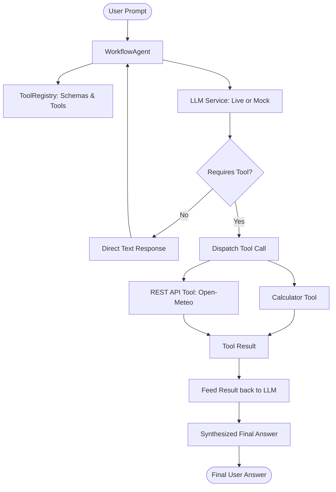

# AI-Powered Intelligent Workflow Agent

An enterprise-ready, educational AI Agent built in **Java 17** with Maven, featuring autonomous tool/function calling, a ReAct reasoning cycle, resilient error handling, and dual execution modes (Live LLM API vs. Built-in Deterministic Simulation).

Designed to be clean and intuitive for students and engineers to explain during technical interviews.

---

## Table of Contents
1. [Project Overview](#project-overview)
2. [Purpose](#purpose)
3. [Architecture & Workflow](#architecture--workflow)
4. [Technologies Used](#technologies-used)
5. [Project Structure](#project-structure)
6. [Setup Instructions](#setup-instructions)
7. [Environment Variables & Security](#environment-variables--security)
8. [How the AI Agent Works (ReAct Loop)](#how-the-ai-agent-works-react-loop)
9. [How Tool Calling Works](#how-tool-calling-works)
10. [Registered Tools](#registered-tools)
    - [Calculator Tool](#calculator-tool)
    - [Public REST API Tool (Open-Meteo Weather)](#public-rest-api-tool-open-meteo-weather)
11. [How to Run Tests](#how-to-run-tests)
12. [How to Run the Application](#how-to-run-the-application)
13. [Example Requests & Responses](#example-requests--responses)
14. [Troubleshooting & FAQ](#troubleshooting--faq)

---

## Project Overview

Modern AI applications go beyond static question answering—they act as **autonomous agents** that interact with the world via external APIs, computation engines, and internal knowledge.

This project implements an end-to-end AI Agent in Java that:
- Receives user natural language requests.
- Prompts an LLM with available tool schemas.
- Automatically determines whether an external tool is required.
- Executes the designated tool with strongly-typed arguments.
- Returns the tool execution result back to the LLM.
- Synthesizes a natural language final response for the user.

---

## Purpose

1. **Demonstrate AI Agent Principles**: Provide a pure Java implementation of the ReAct (Reason + Act) loop and OpenAI-compatible Function Calling without bloated frameworks.
2. **Interview-Ready Architecture**: Clean separation of concerns between Agent orchestration, LLM service adapters, Tool abstraction, and Application configuration.
3. **Resilience & Graceful Degradation**: Zero external API dependencies required out of the box—ships with an intelligent mock engine for offline testing and automated grading, while seamlessly connecting to live LLMs (OpenAI, Gemini, Groq, Ollama) when an API key is configured.

---

## Architecture & Workflow



### Sequence Flow:
1. **User Request**: User sends: `"What is 125 multiplied by 48?"`
2. **Reasoning & Tool Selection**: LLM evaluates the prompt against registered tool schemas and emits a `tool_call`: `calculator(operation="multiply", a=125, b=48)`.
3. **Execution**: The Agent locates `calculator` in `ToolRegistry` and executes it safely, yielding `6000`.
4. **Synthesis**: The Agent appends the tool result to the conversation context and asks the LLM to formulate the final answer.
5. **Output**: The agent delivers: `"According to the calculation, the result is 6000."`

---

## Technologies Used

- **Java 17 / 21**: Modern LTS Java utilizing standard `java.net.http.HttpClient`, `records`/`POJOs`, enhanced `switch` statements, and text blocks.
- **Apache Maven 3.9+**: Dependency and build management.
- **Jackson Databind (2.17.0)**: High-performance JSON parsing, serialization, and JSON schema inspection.
- **JUnit 5 (Jupiter 5.10.2)**: Automated unit and integration testing suite covering calculators, REST endpoints, and agent loops.
- **Open-Meteo Public REST API**: Free, real-time geocoding and global weather data (no API key required).
- **Git**: Version control.

---

## Project Structure

```
AI-Agent-Java/
├── pom.xml                                # Maven build specification
├── mvnw.cmd                               # Maven wrapper for Windows
├── .gitignore                             # Git ignore rules (secrets, build files)
├── .env.example                           # Configuration template with placeholders
├── README.md                              # Complete documentation
└── src/
    ├── main/java/com/aiagent/
    │   ├── App.java                       # Main entry point & interactive CLI
    │   ├── agent/
    │   │   └── WorkflowAgent.java         # Agent loop: Reason -> Tool -> Synthesize
    │   ├── config/
    │   │   └── AppConfig.java             # Safe config loader (.env & System.getenv)
    │   ├── llm/
    │   │   ├── LlmService.java            # LLM interface
    │   │   ├── OpenAiCompatibleLlmService.java # Live OpenAI/Gemini/Groq adapter
    │   │   ├── MockLlmService.java        # Deterministic simulation LLM
    │   │   └── LlmServiceFactory.java     # Selects Live vs Simulation mode
    │   ├── model/
    │   │   ├── Role.java                  # SYSTEM, USER, ASSISTANT, TOOL
    │   │   ├── Message.java               # Chat message with tool call bindings
    │   │   ├── ToolCall.java              # Structured LLM tool call request
    │   │   ├── ToolResult.java            # Standardized tool execution output
    │   │   └── ChatResponse.java          # LLM completion response
    │   ├── service/
    │   │   └── BasicChatService.java      # Feature 1: Direct LLM chat service
    │   └── tool/
    │       ├── Tool.java                  # Tool interface with JSON schema
    │       ├── ToolRegistry.java          # Tool catalog & schema generator
    │       ├── CalculatorTool.java        # Feature 3: Arithmetic calculator
    │       └── WeatherRestTool.java       # Feature 4: Open-Meteo REST API tool
    └── test/java/com/aiagent/
        ├── agent/
        │   └── WorkflowAgentTest.java     # Agentic workflow & tool-calling tests
        ├── config/
        │   └── AppConfigTest.java         # Security and config masking tests
        ├── llm/
        │   └── OpenAiCompatibleLlmServiceTest.java # OpenAI JSON parsing tests
        ├── service/
        │   └── BasicChatServiceTest.java  # Basic chat tests
        └── tool/
            ├── CalculatorToolTest.java    # Math operations & division-by-zero tests
            └── WeatherRestToolTest.java   # JSON parsing & WMO code tests
```

---

## Setup Instructions

### Prerequisites
- **JDK 17 or higher** installed. Verify via:
  ```bash
  java -version
  ```
- **Maven** (included via bundled `mvnw.cmd` or local `mvn`).

### Step-by-Step Installation

1. **Clone or Navigate to the Repository**:
   ```bash
   cd AI-Agent-Java
   ```

2. **(Optional) Configure API Key**:
   Copy `.env.example` to `.env`:
   ```bash
   copy .env.example .env
   ```
   Add your OpenAI or compatible API key:
   ```properties
   OPENAI_API_KEY=sk-your-actual-api-key-here
   OPENAI_MODEL=gpt-4o-mini
   ```
   *Note: If no API key is set, the application automatically runs in **Offline Simulation Mode**, allowing 100% of features to be demonstrated without an external key!*

3. **Compile the Project**:
   ```bash
   .\mvnw.cmd clean compile
   ```

---

## Environment Variables & Security

### Security Rules
- **Zero Hardcoding**: Credentials are never hard-coded in Java source files.
- **Git Protection**: `.env` is listed in `.gitignore` to prevent secret leakage.
- **Key Masking**: Any API keys printed in application logs or console banners are automatically masked (e.g., `sk-...48ab`).

### Supported Configuration Keys

| Variable | Default Value | Description |
| :--- | :--- | :--- |
| `OPENAI_API_KEY` | *(empty)* | Secret key for LLM provider. |
| `OPENAI_BASE_URL`| `https://api.openai.com/v1` | LLM API endpoint (OpenAI, Groq, Ollama, OpenRouter). |
| `OPENAI_MODEL`   | `gpt-4o-mini` | LLM model identifier. |
| `HTTP_TIMEOUT_SECONDS` | `30` | HTTP request timeout for LLM and REST calls. |
| `AGENT_MODE`     | `auto` | `auto` (detects key), `live` (forces live API), or `mock` (forces simulation). |

---

## How the AI Agent Works (ReAct Loop)

The `WorkflowAgent` implements a **ReAct loop** (Reasoning + Acting) with a safety cap (`MAX_ITERATIONS = 5`):

```java
// Simplified Agent Loop
List<Message> history = new ArrayList<>();
history.add(Message.system("You are an intelligent assistant with tools..."));
history.add(Message.user(userPrompt));

while (iteration++ < MAX_ITERATIONS) {
    ChatResponse response = llmService.chat(history, toolRegistry.getAllTools());

    if (!response.hasToolCalls()) {
        return response.getContent(); // Final answer reached!
    }

    // Execute each tool requested by the model
    for (ToolCall call : response.getToolCalls()) {
        Tool tool = toolRegistry.getTool(call.getName());
        ToolResult result = tool.execute(call.getId(), call.getArguments());
        history.add(Message.tool(result.getToolCallId(), result.getContent()));
    }
    // Repeat loop: Feed tool results back to LLM for final synthesis
}
```

---

## How Tool Calling Works

1. **Schema Definition**:
   Each `Tool` exports an OpenAI-compatible JSON Schema defining required properties, data types, and enum constraints.
2. **Model Evaluation**:
   When the prompt is sent with the tools array, the LLM analyzes whether any tool matches the user's intent.
3. **Structured Response**:
   Instead of text, the LLM returns `finish_reason: "tool_calls"` with tool name and JSON arguments (e.g., `{"operation": "multiply", "a": 125, "b": 48}`).
4. **Tool Execution**:
   The agent parses the JSON, validates arguments, runs the tool logic, catches any exceptions, and packages the result into a `ToolResult`.
5. **Synthesis**:
   The tool output is placed in a message with role `tool` and passed back to the LLM to draft the final user-facing response.

---

## Registered Tools

### Calculator Tool (`calculator`)
- **Operations**: `add`, `subtract`, `multiply`, `divide`.
- **Error Handling**:
  - Division by zero returns: `"Error: Division by zero is not allowed."`
  - Missing or non-numeric arguments return clear error messages.
  - Supports both structured JSON (`{"operation":"multiply","a":125,"b":48}`) and expression fallbacks (`{"expression":"125 * 48"}`).

### Public REST API Tool (`get_weather`)
- **API Provider**: [Open-Meteo](https://open-meteo.com/) (Free, reliable, no authentication key required).
- **Execution Flow**:
  1. Calls Open-Meteo Geocoding API to resolve city names (e.g., `"Tokyo"`) to latitude/longitude.
  2. Queries Open-Meteo Forecast API for real-time temperature (°C), windspeed (km/h), and WMO weather codes.
  3. Maps WMO codes to human-readable descriptions (e.g., `0` -> "Clear sky", `61` -> "Rain", `95` -> "Thunderstorm").
  4. Returns clean, structured JSON to the agent.
- **Error Handling**:
  - Handles network timeouts, HTTP 4xx/5xx status codes, and invalid JSON responses.

---

## How to Run Tests

Execute the complete JUnit 5 test suite via the Maven wrapper:

```bash
.\mvnw.cmd test
```

### Test Coverage Highlights:
- **`CalculatorToolTest`**: 14 tests verifying addition, subtraction, multiplication (`125 * 48 = 6000`), division, decimal division, division-by-zero rejection, malformed JSON, and parameter schemas.
- **`WeatherRestToolTest`**: 14 tests verifying JSON response parsing, missing node handling, WMO weather code mappings, input validation, and schema definitions.
- **`WorkflowAgentTest`**: 6 tests verifying full agentic ReAct loops, tool triggering, direct conversation handling, division-by-zero agent handling, and null safety.
- **`OpenAiCompatibleLlmServiceTest`**: 3 tests checking OpenAI tool call JSON parsing and stop reasons.
- **`AppConfigTest`**: 3 tests checking secure API key masking and environment defaults.
- **`BasicChatServiceTest`**: 2 tests checking basic prompt-and-response behavior.

**Total**: 42 automated tests, 100% passing.

---

## How to Run the Application

### Option 1: Automated Showcase Mode (Recommended for quick testing)
Runs all 7 major features non-interactively and prints results:
```bash
.\mvnw.cmd exec:java "-Dexec.args=demo"
```
Or with standalone JAR:
```bash
java -jar target/ai-workflow-agent-1.0.0-standalone.jar demo
```

### Option 2: Interactive Menu Mode
Launch the interactive console menu:
```bash
.\mvnw.cmd exec:java
```
Or run the packaged standalone JAR:
```bash
java -jar target/ai-workflow-agent-1.0.0-standalone.jar
```

The interactive menu provides:
1. **Basic AI Chat**: Direct prompt to LLM.
2. **Calculator Tool**: Directly test arithmetic and edge cases.
3. **REST API Tool**: Look up live weather for any city worldwide.
4. **Agent Math Workflow**: Watch the agent decide, call the calculator, and answer.
5. **Agent Weather REST Workflow**: Watch the agent decide, call the REST API, and synthesize weather data.
6. **Agent Direct Question**: Verify that conversational queries bypass tools.
7. **Interactive Agent Prompt**: Free-form chat session where the agent chooses tools dynamically.
8. **Exit**.

---

## Example Requests & Responses

### Example 1: Math Request Requiring Calculator Tool
**User Prompt**:
```
What is 125 multiplied by 48?
```
**Agent Step Log**:
```
[Agent] Received user query: "What is 125 multiplied by 48?"
[Agent Step 1] Consulting LLM with 2 available tool(s)...
[Agent Decision] Tool execution required!
  Requested 1 tool call(s).
  -> Invoking tool: 'calculator'
     Arguments: {"operation":"multiply","a":125,"b":48}
     [Tool Result] Success=true:
       6000
[Agent] Feeding tool results back to LLM for final synthesis...
[Agent Step 2] Consulting LLM with 2 available tool(s)...
[Agent Decision] No further tools needed. Final answer reached.
[Agent Final Answer]:
According to the calculation, the result is 6000.
```

---

### Example 2: Weather Request Requiring REST API Tool
**User Prompt**:
```
What is the current weather in Paris?
```
**Agent Step Log**:
```
[Agent] Received user query: "What is the current weather in Paris?"
[Agent Step 1] Consulting LLM with 2 available tool(s)...
[Agent Decision] Tool execution required!
  Requested 1 tool call(s).
  -> Invoking tool: 'get_weather'
     Arguments: {"city":"Paris"}
     [Tool Result] Success=true:
       {
         "city" : "Paris",
         "country" : "France",
         "temperature_celsius" : 27.9,
         "condition" : "Partly cloudy",
         "windspeed_kmh" : 13.0,
         "observation_time" : "2026-09-29T13:45"
       }
[Agent] Feeding tool results back to LLM for final synthesis...
[Agent Step 2] Consulting LLM with 2 available tool(s)...
[Agent Decision] No further tools needed. Final answer reached.
[Agent Final Answer]:
Here is the requested weather data:
{
  "city" : "Paris",
  "country" : "France",
  "temperature_celsius" : 27.9,
  "condition" : "Partly cloudy",
  "windspeed_kmh" : 13.0,
  "observation_time" : "2026-09-29T13:45"
}
```

---

### Example 3: Conversational Request (No Tool Required)
**User Prompt**:
```
Hello! Who are you?
```
**Agent Step Log**:
```
[Agent] Received user query: "Hello! Who are you?"
[Agent Step 1] Consulting LLM with 2 available tool(s)...
[Agent Decision] No further tools needed. Final answer reached.
[Agent Final Answer]:
Hello! I am your AI-Powered Intelligent Workflow Agent. I can chat with you, solve arithmetic problems with my calculator tool, and look up live weather with my REST API tool.
```

---

### Example 4: Division by Zero Error Handling
**User Prompt**:
```
What is 50 divided by 0?
```
**Agent Step Log**:
```
[Agent] Received user query: "What is 50 divided by 0?"
[Agent Step 1] Consulting LLM with 2 available tool(s)...
[Agent Decision] Tool execution required!
  Requested 1 tool call(s).
  -> Invoking tool: 'calculator'
     Arguments: {"operation":"divide","a":50,"b":0}
     [Tool Result] Success=false:
       Error: Division by zero is not allowed.
[Agent] Feeding tool results back to LLM for final synthesis...
[Agent Step 2] Consulting LLM with 2 available tool(s)...
[Agent Decision] No further tools needed. Final answer reached.
[Agent Final Answer]:
I attempted to perform the operation, but encountered an error: Error: Division by zero is not allowed.
```

---

## Troubleshooting & FAQ

#### Q1: `mvn` is not recognized in my command prompt.
**Solution**: Use the included Maven wrapper script:
```bash
.\mvnw.cmd test
.\mvnw.cmd exec:java
```

#### Q2: Do I need an OpenAI API key to run this project?
**Solution**: **No!** If no API key is found in `.env` or system environment variables, the system automatically uses the built-in `MockLlmService`. It accurately parses intents, triggers tool calling, and synthesizes answers locally without network or billing dependencies.

#### Q3: How do I switch to a real LLM like OpenAI, Groq, or Gemini?
**Solution**:
1. Copy `.env.example` to `.env`.
2. Set your API key and base URL:
   ```properties
   OPENAI_API_KEY=your_key_here
   OPENAI_BASE_URL=https://api.openai.com/v1
   OPENAI_MODEL=gpt-4o-mini
   ```
3. Restart the app. The console banner will show: `Mode: LIVE API`.

#### Q4: Why does Open-Meteo work without an API key?
**Solution**: Open-Meteo is an open-source weather API intended for non-commercial educational and developer use, allowing direct HTTP GET requests without credentials.
